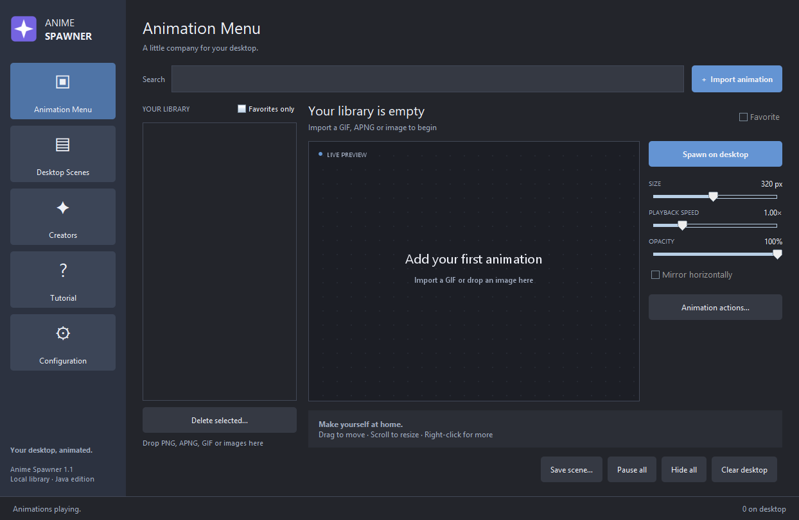

# Anime Spawner

Import your own GIFs and images and place them on your Windows desktop. Anime Spawner uses transparent, draggable windows with controls for size, playback speed, opacity and mirroring.

The library starts empty. No characters, animation packs or sample media are bundled.



## Run

For a packaged build, extract the ZIP and open **Anime Spawner.exe**. Keep the `app` and `runtime` folders beside it. The runtime is included; no separate Java installation is needed.

To run from source, install JDK 21+ and use:

```bat
build.cmd run
```

## Import and manage animations

- Click **Import animation** or drop files into the library. Animated GIF, APNG, PNG, JPEG and BMP are supported.
- Select an item and click **Spawn on desktop**. Drag it to move; scroll to resize; double-click to pause. Right-click for more controls.
- Click **Delete selected…** to remove an import. After confirmation, its library copy, assigned sound and desktop instances are removed. The original files you imported remain untouched.
- Save an arrangement under **Desktop Scenes**. Scenes refer to library items, so scenes using a deleted animation need updating.

Closing the manager leaves the app in the system tray when available. Use the tray menu or **Configuration → Quit Anime Spawner** to exit.

## Features

- Animated GIF and APNG playback with transparency.
- Search, favorites, per-animation settings and multiple desktop instances.
- Saved scenes, optional session restoration and multi-monitor placement.
- Global pause/hide controls and per-instance pause/drag lock.
- Sprite-sheet import, background-color removal, GIF export and PNG frame export.
- WAV, AIFF and AU sounds on spawn.
- Optional video and WebP conversion using a separately installed FFmpeg executable.

FFmpeg conversion takes the first eight seconds at 15 fps and 320-pixel width. Set its executable path in Configuration. Steam Workshop, AI segmentation, click-through and native video playback are not included.

## Build and test

```bat
build.cmd
build.cmd test
```

The JAR is written to `work/jars/anime-spawner.jar`. Tests cover GIF/APNG decoding, transparency, deletion and rollback, persistence, empty-library startup and desktop overlays. Test media is generated in an isolated temporary directory and is not bundled with the app.

To produce a Windows app with its runtime:

```powershell
./package.ps1
```

The package is written to `work/packages/Anime Spawner/`. Use a fresh `-Destination` for another build.

## Data and limits

Packaged builds store their library in `app/data/`; source launches through `build.cmd run` use `data/`. Back up that directory to retain imports and scenes. Scene exports contain settings and library IDs, not embedded media.

Imports are limited to 100 MB per file, 600 frames and about 192 MB of decoded pixels per animation. The app supports up to 24 desktop instances and a 1 GB Java heap. GIF export has the usual palette and binary-transparency limitations. The app does not upload files or download animation packs.

## Project layout

```text
src/animespawner/       Application, renderer, codecs and persistence
tests/animespawner/     Codec and desktop regression tests
tools/animespawner/     Build-time icon generation
docs/                  Screenshot and release notes
```

The interface takes inspiration from [Anima Engine](https://store.steampowered.com/app/3474900/Anima_Engine/). This is an independent implementation. APNG composition follows the [W3C PNG specification](https://www.w3.org/TR/png-3/).

